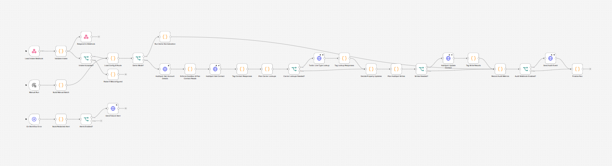

# n8n-outbound-phone-e164-line-type-normalizer

An n8n workflow that normalizes inbound lead phone numbers into strict **E.164** the moment a contact arrives. It then classifies each number's **line type** (mobile, landline, fixed VoIP, non-fixed VoIP, toll-free) through a carrier lookup, writes the results to HubSpot contact properties, and logs masked audit metrics. Outbound SMS and dialing tools can then filter on clean, typed numbers instead of texting landlines or dialing malformed strings.

I built it because outbound tooling fails quietly on phone data. A number like `(555) 555-0101 ext. 204` breaks SMS tools, a landline in an SMS sequence burns sender reputation, and a UK number typed as `07700 900123` with no country context dials the wrong place.

Out of the box it is **offline and read-only**:

- While `HUBSPOT_PRIVATE_APP_TOKEN` is a placeholder, it runs against bundled fictional contacts and makes no network calls.
- `DRY_RUN=true` and `SANDBOX_MODE=true` stay on unless they are explicitly set to `false`.
- `LOOKUP_PROVIDER=mock` means no paid lookups happen until you choose a carrier.

---

## Contents

1. [Architecture overview](#architecture-overview)
2. [What gets written to HubSpot](#what-gets-written-to-hubspot)
3. [Normalization rules](#normalization-rules)
4. [Safety model](#safety-model)
5. [Prerequisites](#prerequisites)
6. [Quick start](#quick-start)
7. [Environment variables](#environment-variables)
8. [config.example.json](#configexamplejson)
9. [n8n node setup](#n8n-node-setup)
10. [Deployment](#deployment)
11. [Audit metrics and error handling](#audit-metrics-and-error-handling)
12. [CLI and scripts](#cli-and-scripts)
13. [Tests and lint](#tests-and-lint)
14. [Repository layout](#repository-layout)
15. [Limits and what I could not verify](#limits-and-what-i-could-not-verify)
16. [Disclaimer and license](#️-disclaimer--liability-limitation)

---

## Architecture overview



```
HubSpot workflow "Send a webhook" ─▶ Lead Intake Webhook ─▶ Validate Intake ─┬─▶ Respond to Webhook (202 / 400 / 401 / 503)
                                                                              └─▶ Intake Accepted? ─no─▶ Raise If Misconfigured
Manual Run ─▶ Build Manual Batch ────────────────────────────────────────────────────┐ yes
                                                                                     ▼
                                       Load Config & Route ─▶ Demo Mode? ─yes─▶ Run Demo Normalization ──────────────┐
                                                                    │ no                                              │
  HubSpot: Get Account Details ◀────────────────────────────────────┘                                                 │
  ▶ Enforce Sandbox & Plan Contact Reads ▶ HubSpot: Get Contact ▶ Tag Contact Responses                               │
  ▶ Plan Carrier Lookups (cache · de-dupe · fictional skip · daily budget) ▶ Carrier Lookups Needed?                  │
  ▶ Twilio: Line Type Lookup ▶ Tag Lookup Responses                                                                   │
  ▶ Decide Property Updates ▶ Plan HubSpot Writes ▶ Writes Needed? ▶ HubSpot: Update Contact ▶ Tag Write Results      │
  ▶ Record Audit Metrics ◀────────────────────────────────────────────────────────────────────────────────────────────┘
  ▶ Audit Webhook Enabled? ▶ Send Audit Event ▶ Finalize Run (fails the execution if any update failed)

On Workflow Error ▶ Build Redacted Alert ▶ Alerts Enabled? ▶ Send Failure Alert
```

- **Intake.** A HubSpot workflow (enrollment trigger: contact created, or phone number known) sends the contact ID with a shared-secret header. The webhook answers `202` straight away and the contact is processed after the response.
- **Read.** The workflow re-reads the contact from HubSpot rather than trusting the payload, so the phone fields, country hint and previous results are current.
- **Normalize.** `src/core/phone.js` is a dependency-free parser. It handles `+`, `00` and `011` prefixes, trunk prefixes, the `(0)` convention, extensions, multi-number fields, per-country length rules, North American Numbering Plan structure, and reserved fictional ranges.
- **Classify.** One carrier lookup runs per distinct number. Cached results (90 days by default) and fictional numbers skip the lookup, and a daily budget caps spend.
- **Decide and write.** The workflow computes the target properties and PATCHes only the ones that changed. Unchanged contacts are never rewritten.
- **Audit.** Each run produces an event with counts and masked numbers (`+1 ******0100`). Daily totals for 30 days are kept in workflow static data, and the event can optionally be POSTed to your log endpoint.

The Code nodes plan every request and parse every response, and the HTTP Request nodes execute them. All logic lives in `src/core/*.js`, and `scripts/build-workflow.js` embeds it into `workflow.json`. The Node.js mirror (`src/core/pipeline.js`) runs the same functions in the same order. The tests run the generated workflow in a simulator and require identical decisions and an identical final HubSpot state.

---

## What gets written to HubSpot

Each configured phone field (default: `phone`, then `mobilephone`, in priority order) gets three properties:

| Property | Example | Values |
|---|---|---|
| `phone_e164` | `+15555550100` | E.164, or blank when invalid or missing |
| `phone_line_type` | `mobile` | `mobile`, `landline`, `fixed_voip`, `non_fixed_voip`, `toll_free`, `other`, `unknown` |
| `phone_normalization_status` | `valid` | `valid`, `invalid`, `fictional`, `missing` |

The `mobilephone_*` properties follow the same pattern. Contact-level summary properties:

| Property | Meaning |
|---|---|
| `outbound_sms_eligible` | `true` when a number's line type is in `SMS_ELIGIBLE_LINE_TYPES` (default: mobile only) |
| `outbound_dial_eligible` | `true` when a number's line type is in `DIAL_ELIGIBLE_LINE_TYPES` |
| `outbound_best_sms_number` | First SMS-eligible number, in field priority order. **Point SMS tools here.** |
| `outbound_best_dial_number` | First dial-eligible number. **Point dialers here.** |
| `outbound_phone_carrier` | Carrier of the best number, when the lookup returns one |
| `outbound_phone_extension` | Extension removed during normalization |
| `outbound_phone_checked_at` | When a carrier lookup last ran (drives the cache) |
| `outbound_phone_issues` | Plain-language notes, such as "phone held more than one number (the first was used)" |

The source fields (`phone`, `mobilephone`) are **not** changed unless `OVERWRITE_SOURCE_PHONE_FIELDS=true`. Even then, only valid numbers without an extension are overwritten. `npm run properties:create` creates all 14 properties.

> "SMS eligible" describes the line type only. It is **not** consent. Combine it with your opt-in and subscription properties before any message is sent.

---

## Normalization rules

| Input | Default country | Result |
|---|---|---|
| `(555) 555-0100` | US | `+15555550100` (fictional range) |
| `555.555.0101 ext. 204` | US | `+15555550101`, extension `204` |
| `+44 (0)20 7946 0018` | any | `+442079460018` |
| `07700 900123` | GB (or contact country United Kingdom) | `+447700900123` |
| `00 44 7700 900456` / `011 44 7700 900456` | any / NANP | `+447700900456` |
| `447700900123` | US | `+447700900123`, issue "missing + prefix" |
| `555-555-0100 / 555-555-0101` | US | first number, issue "more than one number" |
| `call me maybe` | any | invalid: contains letters |
| `555-0199` | US | invalid: not 10 digits |
| `(911) 555-0100` | US | invalid: area code |

- **Country context.** The contact's `country` property (an ISO code or a name such as "United Kingdom") overrides `DEFAULT_COUNTRY`.
- **Supported countries.** Length rules exist for 34 countries: US, CA, PR, GB, IE, DE, FR, ES, IT, NL, BE, CH, AT, SE, NO, DK, FI, PL, PT, AU, NZ, IN, SG, HK, JP, CN, BR, MX, ZA, AE, BD, PH and IL. Any other country code is accepted as E.164 when it has 8 to 15 digits, and is flagged as "unrecognised country code".
- **Fictional ranges.** These ranges are marked `fictional`:
  - NANP 555-0100 to 555-0199
  - Ofcom drama numbers, such as 07700 900xxx and 020 7946 0xxx
  - ACMA fictional numbers, such as 0491 570 156 and 02 5550 xxxx

  With a real carrier, fictional numbers are never looked up and never become eligible. Every sample number in this repository is in one of these ranges.
- **What the parser does not do.** It checks format and structure, not whether a number is in service. The carrier lookup answers that.

---

## Safety model

| Layer | Default | Effect |
|---|---|---|
| Demo mode | on while the HubSpot token is a placeholder | Bundled fictional contacts, mock HubSpot, mock line types, no network |
| `DRY_RUN` | `true` | Reads, looks up and decides, but never PATCHes. Only `false/0/no/off` disables it. |
| `SANDBOX_MODE` | `true` | Checks `/account-info/v3/details` and stops unless the portal is `SANDBOX` or `DEVELOPER_TEST`, or matches `HUBSPOT_SANDBOX_PORTAL_ID` |
| `LOOKUP_PROVIDER` | `mock` | Simulated line types. Writing mock results is allowed only into a sandbox, and live mode refuses to start with it. |
| Live-mode lock | | When `DRY_RUN=false` and `SANDBOX_MODE=false`, the workflow refuses placeholders, mock lookups and stub-only switches |
| Webhook authentication | | Shared secret of at least 24 characters, compared in constant time. Wrong secret: `401`. Misconfigured: `503`, and the execution fails so the error branch alerts. |
| Lookup budget | 500 per UTC day | Numbers over the budget become `unknown` and are retried by the next run |
| Lookup cache | 90 days | A contact whose stored E.164 and line type are fresh is not looked up again |
| Idempotent writes | | Only changed properties are sent. The checked-at timestamp moves only after a real lookup. |
| No credentials in the export | | The HubSpot token and Twilio credentials are read from `$env` inside HTTP expressions, so they are never stored in nodes or item data. Successful executions are not saved. |
| Privacy | | Responses, audit events and alerts carry masked numbers. Alerts redact tokens, Basic auth headers, Twilio SIDs, webhook URLs and anything shaped like a phone number. |

---

## Prerequisites

- **n8n** 1.x (self-hosted, or any plan with environment variables), with these nodes: Webhook v2, Respond to Webhook v1.1, Code v2, IF v2, HTTP Request v4.2 and Error Trigger.
- **n8n host setting:** `N8N_BLOCK_ENV_ACCESS_IN_NODE=false`, so Code nodes and expressions can read `$env`.
- **A HubSpot private app**, starting in a sandbox or developer test account, with these scopes:
  - `crm.objects.contacts.read`
  - `crm.objects.contacts.write`
  - `crm.schemas.contacts.write`, only for `npm run properties:create`
- **Optional: a Twilio account** with Lookup v2 Line Type Intelligence, which is billed per lookup. Twilio documents worldwide coverage, but Canadian numbers need special approval.
- **Node.js 20+** for the CLI, tests and lint. There are no npm dependencies.

---

## Quick start

```bash
npm run verify                                   # lint + workflow freshness check + 49 tests
npm run demo                                     # normalize 11 fictional contacts offline
npm run normalize -- "+44 (0)20 7946 0018"       # check one number, no lookup
```

`npm run demo` prints one line per contact, for example `103 sms_ready changes phone=fictional/landline +44 ******0018 mobilephone=fictional/mobile +44 ******0123`. The 11 contacts produce 5 SMS-ready, 2 dial-only and 4 not contactable. Contact 106 is skipped as unchanged because its cached line type is still fresh.

To try it in n8n: import `workflow.json` and click **Execute workflow** on **Manual Run**. With placeholder variables it runs the demo, and **Finalize Run** shows the counters.

---

## Environment variables

| Variable | Default | Purpose |
|---|---|---|
| `HUBSPOT_PRIVATE_APP_TOKEN` | `YOUR_HUBSPOT_TOKEN_HERE` | Private app token. A placeholder means demo mode. |
| `HUBSPOT_BASE_URL` | `https://api.hubapi.com` | API base URL |
| `HUBSPOT_SANDBOX_PORTAL_ID` | placeholder | Portal that `SANDBOX_MODE` also accepts |
| `WEBHOOK_SECRET` | placeholder | Shared secret of at least 24 characters (required in HubSpot mode) |
| `WEBHOOK_SECRET_HEADER` | `x-webhook-secret` | Header that carries the secret |
| `LOOKUP_PROVIDER` | `mock` | `mock` or `twilio` |
| `TWILIO_ACCOUNT_SID` / `TWILIO_AUTH_TOKEN` | placeholders | Twilio credentials, used only from `$env` |
| `TWILIO_LOOKUP_BASE_URL` | `https://lookups.twilio.com` | Point at a stub server for integration tests |
| `MAX_LOOKUPS_PER_DAY` | `500` | Daily lookup budget (UTC) |
| `LOOKUP_CACHE_DAYS` | `90` | Reuse stored line types for this long (`0` turns the cache off) |
| `LOOKUP_FICTIONAL_NUMBERS` | `false` | Send fictional numbers to the lookup endpoint. For stub servers only; refused in live mode. |
| `DRY_RUN` | `true` | Plan writes without writing |
| `SANDBOX_MODE` | `true` | Sandbox portals only |
| `DEFAULT_COUNTRY` | `US` | Country assumed for national-format numbers without a contact country |
| `OVERWRITE_SOURCE_PHONE_FIELDS` | `false` | Replace `phone` and `mobilephone` with their E.164 form |
| `SMS_ELIGIBLE_LINE_TYPES` | `mobile` | Comma-separated line types allowed for SMS |
| `DIAL_ELIGIBLE_LINE_TYPES` | `mobile,landline,fixed_voip,non_fixed_voip` | Line types allowed for dialing |
| `MAX_LEADS_PER_REQUEST` | `100` | Contact IDs accepted per webhook call |
| `NORMALIZER_CONFIG_JSON` | placeholder | Optional one-line JSON with phone fields and property names (see `config.example.json`) |
| `AUDIT_WEBHOOK_URL` | placeholder | Optional HTTPS endpoint for masked audit events |
| `ALERT_WEBHOOK_URL` | placeholder | Optional HTTPS endpoint (for example a Slack incoming webhook) for redacted failure alerts |
| `MANUAL_TEST_CONTACT_IDS` | placeholder | Sandbox contact IDs that **Manual Run** processes in HubSpot mode |
| `NORMALIZER_NOW` | empty | Testing only: pins the clock |

Every variable is in `.env.example`, and `config.example.json` repeats them in its `environment` block.

---

## config.example.json

The template holds:

- the `environment` block above
- `normalization`: default country, country property, phone fields with their three output properties each, and whether source fields are overwritten
- `eligibility`: the SMS and dial line types
- `properties`: names for the eight summary properties
- `lookup`: provider, daily budget and cache days
- `maxLeadsPerRequest`
- `sampleLeads`: fictional sample contacts and a webhook body

The built-in defaults match the template. You only need `NORMALIZER_CONFIG_JSON` in n8n when you rename properties or change the phone fields. Minify everything except `environment` and `sampleLeads` into one line:

```bash
node -e "const c=require('./config.json');delete c.environment;delete c.sampleLeads;delete c._comment;console.log('NORMALIZER_CONFIG_JSON='+JSON.stringify(c))"
```

---

## n8n node setup

| Node | Setup notes |
|---|---|
| **Lead Intake Webhook** | `POST /webhook/outbound-phone-normalizer`, Respond: *Using 'Respond to Webhook' node*. Copy the production URL into your HubSpot workflow. |
| **Validate Intake** | Checks `WEBHOOK_SECRET_HEADER`. Accepts `{ "objectId": 123 }`, `{ "hs_object_id": "123" }`, `{ "contactId": 123 }`, `{ "contactIds": [...] }` or an array of HubSpot webhook events. |
| **Respond to Webhook** | Status from `$json.statusCode`, JSON body `{ requestId, accepted, rejected, mode, dryRun }`. Never echoes the payload. |
| **Raise If Misconfigured** | Fails the execution after a `503`, so the error branch alerts you. |
| **Build Manual Batch** | Demo mode: all bundled contacts. HubSpot mode: `MANUAL_TEST_CONTACT_IDS`. |
| **Load Config & Route** | Validates every setting and pins one clock for the run. |
| **HubSpot: Get Account Details** | Sandbox check. The `Authorization` header is `=Bearer {{ $env.HUBSPOT_PRIVATE_APP_TOKEN }}`. |
| **HubSpot: Get Contact** | `GET /crm/v3/objects/contacts/{id}`. *Continue on error*: a missing contact is reported while the rest of the batch continues. If no contact in the batch can be read, the run fails, which usually means a token or scope problem. |
| **Plan Carrier Lookups** | Cache, de-duplication, fictional skip and the daily budget (in workflow static data). |
| **Twilio: Line Type Lookup** | `GET https://lookups.twilio.com/v2/PhoneNumbers/{E.164}?Fields=line_type_intelligence`. Authorization: `={{ 'Basic ' + ($env.TWILIO_ACCOUNT_SID + ':' + $env.TWILIO_AUTH_TOKEN).base64Encode() }}`. *Continue on error*, so a failure becomes line type `unknown`. Batched at 5 requests per second. |
| **Decide Property Updates** | Pure decision step. Output: per-contact decisions with the property diff. |
| **HubSpot: Update Contact** | `PATCH /crm/v3/objects/contacts/{id}` with changed properties only. *Continue on error*; failures fail the run at **Finalize Run**, after the audit event is recorded. |
| **Record Audit Metrics / Send Audit Event** | Masked event plus daily totals. POSTs to `AUDIT_WEBHOOK_URL` when it is set. |
| **On Workflow Error → Send Failure Alert** | Set *Workflow Settings → Error Workflow* to this workflow, or copy these four nodes into a dedicated error workflow. |

All HTTP nodes retry 3 times, 2 seconds apart.

**Using n8n credentials instead of `$env`.** You can switch the HubSpot nodes to a *Header Auth* credential and the Twilio node to a *Basic Auth* credential. If you do, keep `HUBSPOT_PRIVATE_APP_TOKEN` set to any non-placeholder value so demo mode stays off. Keep `TWILIO_ACCOUNT_SID` and `TWILIO_AUTH_TOKEN` non-placeholder too, because the configuration check still expects them.

---

## Deployment

1. **Set up n8n.** Set `N8N_BLOCK_ENV_ACCESS_IN_NODE=false` on the instance and add the variables from `.env.example`. Restart n8n.
2. **Import `workflow.json`.** It imports inactive. Run **Manual Run** to see the demo.
3. **Create the properties in your sandbox:**
   ```bash
   cp .env.example .env    # sandbox token only
   npm run properties:create                 # prints the 14 payloads
   DRY_RUN=false npm run properties:create   # creates them; existing ones are left alone
   ```
4. **Run a sandbox dry run.** Set the sandbox token, `WEBHOOK_SECRET` (for example from `openssl rand -hex 24`) and `MANUAL_TEST_CONTACT_IDS`, then run **Manual Run**. Check the decisions in **Decide Property Updates**.
5. **Connect HubSpot.** In a HubSpot contact workflow (trigger: *Phone number is known*, or *Contact created*), add **Send a webhook**:
   - method `POST`
   - the n8n production URL
   - authentication with an API key in the header `x-webhook-secret`, set to your secret
   - the body includes the contact record ID

   Activate the n8n workflow.
6. **Enable sandbox writes.** Set `DRY_RUN=false`, keep `LOOKUP_PROVIDER=mock`, and check that properties appear on test contacts. A second run should write nothing.
7. **Use the real carrier.** Set `LOOKUP_PROVIDER=twilio` and the Twilio credentials, then check `MAX_LOOKUPS_PER_DAY` against your budget.
8. **Go to production.** Use the production token, set `SANDBOX_MODE=false`, `DRY_RUN=false` and `ALERT_WEBHOOK_URL`, then switch your SMS and dialer tools to `outbound_best_sms_number` and `outbound_best_dial_number`.

Instead of n8n, you can run `npm start` as a small webhook server on `POST /webhook` with the same intake rules. Put it behind HTTPS.

**Re-trigger loops.** If `OVERWRITE_SOURCE_PHONE_FIELDS=true` and your HubSpot trigger fires on phone changes, the overwrite triggers one extra run. That run finds nothing to change and writes nothing.

---

## Audit metrics and error handling

The audit event (`type: phone_normalizer.run`) contains:

- the request ID, trigger and safety switches
- the lookup budget
- counters: leads, valid, invalid, fictional, missing, each line type, carrier and mock lookups, cache hits, skipped and failed lookups, SMS-ready, dial-only and not-contactable contacts, planned, succeeded and failed writes
- per contact: outcome, write status, masked numbers and changed property names

Workflow static data keeps 30 days of daily totals, shown as `today` in **Finalize Run**. n8n only persists static data for active, production executions.

| Symptom | Meaning | Action |
|---|---|---|
| Webhook returns `401` | Wrong or missing secret header | Check the HubSpot webhook authentication header. |
| Webhook returns `503`, plus an alert | Configuration invalid | Read the alert or execution error, fix the variable. |
| "SANDBOX_MODE=true, but the connected portal…" | Production token in sandbox mode | Use a sandbox token, set `HUBSPOT_SANDBOX_PORTAL_ID`, or set `SANDBOX_MODE=false` on purpose. |
| "No contact could be read" | Every read in the batch failed | Check the token scopes and whether the IDs are contact IDs. |
| `lookupFailures` above 0 | Twilio errors or timeouts | Those numbers are written as `unknown` and not SMS-eligible. They are looked up again next time, because a failure never refreshes the cache. |
| `lookupsSkipped` above 0 | Budget used up, or fictional numbers | Raise `MAX_LOOKUPS_PER_DAY` or wait for the next UTC day. |
| "N HubSpot contact update(s) failed" | PATCH errors | Successful updates are kept. Re-send the failed contact IDs; the run is idempotent. |

---

## CLI and scripts

| Command | Purpose |
|---|---|
| `npm run demo` (`--json` for full output) | Offline demo |
| `npm run normalize -- "<number>" --country GB` | Check one number (exit code 2 if it is invalid) |
| `npm run run:contacts -- 101,102` | Process HubSpot contacts with `.env` / `config.json`. The budget and metrics persist in `data/state.json`. |
| `npm start` | Local webhook server on port 8787 |
| `npm run properties:create` | Create the 14 contact properties (dry run by default) |
| `npm run build:workflow` / `npm run check:workflow` | Regenerate the workflow, or check that `workflow.json` matches `src/core` |
| `npm run lint` | Syntax, JSON, whitespace, secrets, sample-data and documentation-voice checks |

---

## Tests and lint

```bash
npm run verify
```

- **`tests/normalizer.test.js`** covers:
  - E.164 parsing across formats, prefixes, trunks, extensions, invalid input and fictional ranges
  - configuration safety
  - intake authentication and payload shapes
  - Twilio response parsing
  - lookup planning: cache, de-duplication, fictional skip and budget
  - eligibility, failed and invalid lookups, and the overwrite rules
  - audit masking and retention, and redaction
  - idempotent sandbox writes and failed updates
  - sandbox refusal and HTTP retries
- **`tests/workflow.test.js`** runs `workflow.json` in `tests/n8n-simulator.js`. The simulator executes the real Code node source, the IF and HTTP expressions (including the Basic auth expression), paired items and continue-on-error. The tests cover:
  - demo parity with the Node.js mirror
  - a Twilio-backed webhook batch whose decisions **and final HubSpot state** equal the mirror's
  - dry-run behaviour
  - the budget persisting across executions
  - `401`, `503`, sandbox refusal, lookup failure, write failure and the redacted alert
- **`npm run lint`** enforces the repository rules: no tokens, no Twilio SIDs, no Slack webhook paths, no emails outside example.com, and first-person-singular documentation.

---

## Repository layout

```
├── workflow.json                generated n8n export (32 nodes)
├── config.example.json          configuration and environment template, fictional sample leads
├── .env.example                 every variable with safe defaults
├── src/
│   ├── core/
│   │   ├── config.js            loading, validation, safety switches
│   │   ├── phone.js             E.164 parser, country rules, fictional ranges, masking
│   │   ├── lineType.js          Twilio Lookup v2 request, parser and mock
│   │   ├── normalizer.js        analysis, lookup planning, decisions, property diff
│   │   ├── hubspot.js           HubSpot requests, sandbox check, property definitions
│   │   ├── intake.js            webhook authentication and payload parsing
│   │   ├── audit.js             audit events, daily metrics, redaction, alerts
│   │   ├── pipeline.js          Node.js mirror and HTTP client
│   │   └── mocks.js             fictional demo contacts, HubSpot and Twilio mocks
│   └── index.js                 CLI and local webhook server
├── scripts/
│   ├── build-workflow.js        embeds src/core into workflow.json
│   ├── create-properties.js     one-time HubSpot property setup
│   └── lint.js                  dependency-free lint
├── tests/                       node:test suites and the n8n simulator
├── DISCLAIMER.md
└── LICENSE
```

---

## Limits and what I could not verify

I tested against in-memory HubSpot and Twilio mocks and a workflow simulator, not against a live n8n instance, a live portal or the live Twilio API. Before relying on it, please confirm the following in your own environment:

- **`.base64Encode()` in the Twilio header.** The expression relies on n8n's string helper `.base64Encode()`. If your n8n version lacks it, use a *Basic Auth* credential on that node.
- **Continue-on-error output shape.** With `onError: continueRegularOutput`, I assume n8n emits one item per failed request, which the parsers treat as a failure whatever its shape. Check one failed execution after import.
- **Paired items.** The tag nodes pair responses to requests with `$('Node').itemMatching(index)`, the documented pattern for Code nodes.
- **Respond to Webhook.** It runs on a parallel branch from **Validate Intake**, so the workflow does not depend on the node passing items through.
- **Twilio coverage and pricing.** Line Type Intelligence is a paid package; check current pricing and coverage for each country you call. Carrier data can lag number porting, so treat line type as a strong hint rather than a guarantee.
- **The parser is not libphonenumber.** It validates length and structure for 34 countries, not every numbering plan detail. Numbers from other countries pass when they are E.164-shaped, and the carrier lookup's `valid: false` then clears them.
- **No backfill.** It processes contacts on ingestion or by ID. Existing records can be backfilled by sending their IDs in batches of up to `MAX_LEADS_PER_REQUEST`.

---

## Author

**DH Robin | dhRobin Systems**: [https://dhrobinsystems.com](https://dhrobinsystems.com)

I build revenue infrastructure: CRM data integrity, routing and outbound automation for HubSpot portals. Issues and pull requests are welcome.

---

## ⚠️ Disclaimer & Liability Limitation

Use at your own risk. The code, workflows, and scripts provided in this repository (`n8n-outbound-phone-e164-line-type-normalizer`) are for educational and architectural demonstration purposes.

* **No Liability:** The author and dhRobin Systems assume no responsibility or liability for any direct, indirect, incidental, or consequential damages resulting from the use, misuse, or deployment of these scripts.
* **No Warranty:** All software, n8n JSON blueprints, and JavaScript modules are provided "AS IS" without warranty of any kind, express or implied, including but not limited to merchantability, fitness for a particular purpose, or non-infringement.
* **Production Testing Required:** Always test thoroughly in an isolated staging environment (for example a HubSpot developer test account or sandbox) with `SANDBOX_MODE=true` and `DRY_RUN=true` enabled before connecting live HubSpot credentials. Treat every contact property update as a change that sequences, dialers and SMS tools may act on immediately.
* **Third-Party APIs & Compliance:** Users are solely responsible for complying with the terms of service, rate limits, data privacy regulations (GDPR/CCPA), and security policies of HubSpot, Twilio and any connected services. That includes telemarketing and messaging rules such as the TCPA and the equivalent rules of every country contacted, do-not-call registries and carrier messaging policies. An "SMS eligible" flag describes the line type only and is not proof of consent.

The full disclaimer is also available in [DISCLAIMER.md](https://github.com/dhrobinsystems/n8n-outbound-phone-e164-line-type-normalizer/blob/main/DISCLAIMER.md).

## License

Released under the MIT License. Copyright (c) 2026 DH Robin (dhRobin Systems). See [LICENSE](https://github.com/dhrobinsystems/n8n-outbound-phone-e164-line-type-normalizer/blob/main/LICENSE).

DISCLAIMER.md · Licensed under the MIT License. License: MIT © 2026 dhRobin Systems · Provided as-is, see the disclaimer.
